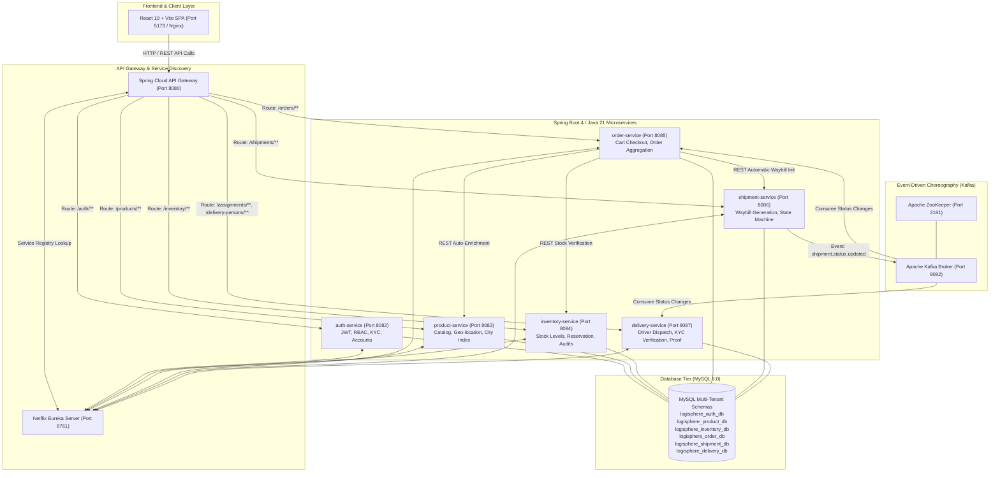

<<<<<<< HEAD
# LogiSphere — Cloud-Native Logistics & Supply Chain Management Platform

LogiSphere is an enterprise-grade, cloud-native logistics and supply chain orchestration platform engineered with a microservices architecture. It provides end-to-end visibility and automation across the supply chain lifecycle — encompassing multi-role authentication (Customer, Seller/Supplier, Administrator, Delivery Partner), real-time inventory management, asynchronous event-driven order processing, shipment tracking, and dispatch coordination.

---

## Architecture Overview

LogiSphere adopts a microservices pattern with event choreography via Apache Kafka, dynamic service discovery with Netflix Eureka, and centralized routing through Spring Cloud API Gateway.



---

## Core Domain Capabilities

### 1. Customer Experience
- **Interactive Catalog**: Browse real-time products with category, price, and city-based geo-filtering.
- **Cart & Instant Checkout**: Real-time stock validation prevents overselling; multi-item checkout with delivery address selection.
- **Enhanced Order History**: Visual order cards showing exact product names, thumbnails, order status badges, and itemized receipts.
- **Live Shipment Tracker**: Six-stage progression timeline (`CREATED` &rarr; `PACKED` &rarr; `SHIPPED` &rarr; `IN_TRANSIT` &rarr; `OUT_FOR_DELIVERY` &rarr; `DELIVERED`) with a 30-second live auto-refresh and manual trigger.

### 2. Seller / Supplier Operations
- **Storefront Onboarding**: Dedicated registration flow with business identification, contact details, and location coordinates.
- **Inventory & Catalog Control**: Add, modify, and restock products with instant synchronization between `product-service` and `inventory-service`.
- **Order Visibility**: Real-time order status tracking to coordinate fulfillment and packaging.

### 3. Delivery Partner Operations
- **Digital KYC Onboarding**: Identity submission including Aadhaar / Government ID, driving license details, vehicle registration, and document uploads with legal age verification.
- **Assignment Dashboard**: View assigned packages, recipient contact and location, and update delivery milestones.
- **Automated Lifecycle Integration**: Status updates automatically trigger Kafka events that update orders and complete delivery assignments.

### 4. Administrator Governance
- **Role-Based Access Control**: Strict JWT token validation ensuring secure operational boundaries.
- **Supplier Verification**: Review pending seller registrations and approve or suspend store accounts.
- **Driver KYC Management**: Review submitted government identity documents, vehicle papers, and manage approval/rejection with an immutable audit trail.
- **System Telemetry**: Real-time service discovery inspection via Eureka and Kafka message queue coordination.

---

## Technology Stack

| Domain | Technology / Library | Version / Details |
|---|---|---|
| **Backend Framework** | Spring Boot / Spring Cloud | Spring Boot 4.1.1, Java 21 (Eclipse Temurin) |
| **API Gateway** | Spring Cloud Gateway (MVC) | Path-based routing, LB load balancing |
| **Service Discovery**| Netflix Eureka | High-availability registration & health checks |
| **Messaging** | Apache Kafka & ZooKeeper | Confluent cp-kafka 7.4.4, cp-zookeeper 7.4.4 |
| **Persistence** | MySQL & Spring Data JPA | MySQL 8.0, Hibernate ORM 7.4 |
| **Security** | Spring Security & JJWT | HMAC-SHA256 Stateless JWT, RBAC filter |
| **Frontend** | React 19 + Vite | React Router DOM 7, Lucide Icons, Fetch/Axios |
| **Containerization**| Docker & Docker Compose | Multi-stage Dockerfiles, Alpine/Jammy JREs |
| **CI / CD** | GitLab CI/CD | 5-Stage Pipeline: test, build, docker, deploy, verify |

---

## Ports and Services Reference

| Service Name | Container Name | Port | Description |
|---|---|---|---|
| **API Gateway** | `logisphere-gateway` | `8080` | Reverse proxy & unified API entry point |
| **Eureka Server** | `logisphere-eureka` | `8761` | Service discovery registry dashboard |
| **Auth Service** | `logisphere-auth` | `8082` | Authentication, JWT, and User Management |
| **Product Service** | `logisphere-product` | `8083` | Product catalog and location search |
| **Inventory Service**| `logisphere-inventory` | `8084` | Stock management and reservations |
| **Order Service** | `logisphere-order` | `8085` | Checkout, order persistence, Kafka consumer |
| **Shipment Service** | `logisphere-shipment` | `8086` | Waybills, status machine, Kafka publisher |
| **Delivery Service** | `logisphere-delivery` | `8087` | Delivery assignment, KYC audit logs |
| **Frontend Web** | `logisphere-frontend` | `5173` | React SPA served via Nginx |
| **MySQL Database** | `logisphere-mysql` | `3306` | Polyglot multi-schema relational storage |
| **Apache Kafka** | `logisphere-kafka` | `9092` | Event broker for status synchronization |
| **Apache ZooKeeper**| `logisphere-zookeeper`| `2181` | Coordination engine for Kafka |

---

## Getting Started

### Prerequisites
- [Docker](https://docs.docker.com/get-docker/) & Docker Compose
- Java 21 JDK (optional, for local Maven development)
- Node.js 20+ (optional, for local Vite development)

### Quick Start with Docker Compose

1. **Clone the repository:**
   ```bash
   git clone https://gitlab.com/hemalatha02205/logisphere.git
   cd logisphere
   ```

2. **Configure Environment Variables:**
   Copy the example environment file and customize your secrets:
   ```bash
   cp .env.example .env
   ```
   Ensure `.env` contains:
   ```properties
   JWT_SECRET=YourSecure256BitOrGreaterSecretKeyHereForTesting
   DB_USERNAME=root
   DB_PASSWORD=root
   ```

3. **Launch the Entire Stack:**
   ```bash
   docker-compose up -d
   ```

4. **Verify Container Health:**
   ```bash
   docker ps
   ```
   Confirm all 12 containers report `Up`.

5. **Access the Applications:**
   - **Frontend Web Portal**: [http://localhost:5173](http://localhost:5173)
   - **API Gateway**: [http://localhost:8080](http://localhost:8080)
   - **Eureka Discovery Dashboard**: [http://localhost:8761](http://localhost:8761)

---

## API Overview

All external requests are routed through the unified API Gateway at `http://localhost:8080`.

| Method | Endpoint | Authorization | Description |
|---|---|---|---|
| `POST` | `/auth/login` | Public | Authenticates credentials and returns JWT token |
| `POST` | `/auth/register` | Public | Register a new Customer |
| `POST` | `/auth/register/supplier` | Public | Register a new Seller/Supplier |
| `POST` | `/auth/register/delivery` | Public | Register a new Delivery Partner with KYC |
| `GET` | `/auth/users` | `ADMIN` | List all registered platform users |
| `GET` | `/auth/suppliers` | `ADMIN` | List all suppliers for verification |
| `PUT` | `/auth/suppliers/{id}/verify`| `ADMIN` | Approve or reject supplier status |
| `GET` | `/products` | Public | List active product catalog |
| `GET` | `/products/{id}` | Public | Get product details by ID |
| `POST` | `/products` | `SUPPLIER` | Add a new product to the catalog |
| `GET` | `/inventory/{productId}` | Public/Internal | Check current stock quantity |
| `POST` | `/orders` | Public / `CUSTOMER` | Place an order (validates stock, creates shipment) |
| `GET` | `/orders/{id}` | `CUSTOMER` / `ADMIN`| Fetch order with product names and thumbnails |
| `GET` | `/orders/customer/{id}` | `CUSTOMER` | Fetch customer's full order history |
| `GET` | `/shipments/order/{orderId}` | Public / `CUSTOMER` | Track shipment status and tracking number |
| `PUT` | `/shipments/{id}/status` | `ADMIN` / System | Transition shipment status (emits Kafka event) |
| `GET` | `/delivery-persons` | `ADMIN` | List all delivery partners |
| `GET` | `/delivery-persons/user/{id}`| Owner / `ADMIN` | Fetch driver KYC and profile information |
| `PUT` | `/delivery-persons/{id}/verify`| `ADMIN` | Approve or reject driver KYC submission |
| `GET` | `/assignments` | `ADMIN` | List all delivery assignments |

---

## Quality Assurance & Verification Report

| Test Suite / Inspection Area | Target | Executed Tests | Result | Evidence |
|---|---|---|---|---|
| **eureka-server** | Discovery Service | 1 Unit/Context Test | **PASS** | Tests run: 1, Failures: 0, Errors: 0 |
| **api-gateway** | Gateway Routes | 1 Context Test | **PASS** | Tests run: 1, Failures: 0, Errors: 0 |
| **auth-service** | Auth & KYC Logic | 9 Unit/Integration Tests | **PASS** | Tests run: 9, Failures: 0, Errors: 0 |
| **product-service** | Catalog Operations | 1 Context Test | **PASS** | Tests run: 1, Failures: 0, Errors: 0 |
| **inventory-service** | Stock Operations | 1 Context Test | **PASS** | Tests run: 1, Failures: 0, Errors: 0 |
| **order-service** | Order & Item Names | 1 Context Test | **PASS** | Tests run: 1, Failures: 0, Errors: 0 |
| **shipment-service** | Waybill State Machine | 1 Context Test | **PASS** | Tests run: 1, Failures: 0, Errors: 0 |
| **delivery-service** | Driver KYC & Dispatch | 17 Unit/Integration Tests| **PASS** | Tests run: 17, Failures: 0, Errors: 0 |
| **Frontend Production Build** | React + Vite Bundle | 1,997 modules minified | **PASS** | `dist/` built in 3.16s, zero errors |
| **Kafka Event Choreography** | `shipment.status.updated`| 5 sequential transitions | **PASS** | Order & Delivery auto-sync verified |
| **Multi-Persona Security (RBAC)**| 4 Roles (Customer, Seller, Admin, Driver)| End-to-end API Matrix | **PASS** | 403 Forbidden enforced on boundaries |

---

## GitLab CI/CD 5-Stage Pipeline

LogiSphere employs a 5-stage automated pipeline in `.gitlab-ci.yml`:

```
+--------+     +---------+     +----------+     +----------+     +----------+
|  test  | --> |  build  | --> |  docker  | --> |  deploy  | --> |  verify  |
+--------+     +---------+     +----------+     +----------+     +----------+
```

1. **`test`**: 8 parallel jobs executing automated unit and context test suites for every Spring Boot microservice against an ephemeral MySQL 8.0 CI service container.
2. **`build`**: Frontend client build (`node:20-alpine`) compiling the React 19 + Vite SPA and persisting `frontend/dist/` as an artifact.
3. **`docker`**: Docker-in-Docker (`docker:29.6.1-dind`) building and publishing all 9 container images to GitLab Container Registry (`$CI_REGISTRY_IMAGE/<service>:$CI_COMMIT_SHA` and `:latest` on `main`).
4. **`deploy`**:
   - `deploy:staging-validation` (Default): Validates `docker-compose.yml` config, image targets, and creates deployment bundle artifact `logisphere-deploy-bundle.tar.gz`.
   - `deploy:production` (Conditional): Manual trigger on `main` when `DEPLOY_SSH_HOST`, `DEPLOY_SSH_USER`, and `DEPLOY_SSH_KEY` are provided.
5. **`verify`**:
   - `verify:preflight-smoke-test` (Default): Validates bundle integrity, service dependencies, and non-conflicting port topology.
   - `verify:live-smoke-test` (Conditional): Probes live gateway and frontend endpoints when `DEPLOY_TARGET_URL` is set.

---

## Project Demonstration Guide

Follow this sequence for an end-to-end college project or stakeholder presentation:

1. **Architecture & Health Inspection**:
   - Open Eureka dashboard at [http://localhost:8761](http://localhost:8761) &rarr; show that all 7 microservices are registered as `UP`.
   - Open Docker Desktop / terminal &rarr; show all 12 containers running concurrently.

2. **Customer Shopping Journey**:
   - Navigate to [http://localhost:5173](http://localhost:5173) and sign in as Customer (`cust1@test.com` / `password`).
   - Browse products, select an item, add to cart, and proceed to checkout.
   - Enter shipping address and click **Place Order**.
   - Navigate to **My Orders** &rarr; verify the new order appears with the item title, thumbnail, and total amount.

3. **Shipment Tracking & Real-Time Kafka Synchronization**:
   - Click **Track Shipment** on the order to open the visual timeline (Status: `CREATED`).
   - Advance the shipment status via the API:
     ```bash
     curl -X PUT "http://localhost:8080/shipments/<shipmentId>/status?status=PACKED"
     curl -X PUT "http://localhost:8080/shipments/<shipmentId>/status?status=SHIPPED"
     curl -X PUT "http://localhost:8080/shipments/<shipmentId>/status?status=DELIVERED"
     ```
   - Observe Kafka processing the event in container logs (`docker logs --tail 20 logisphere-order`).
   - Verify the tracking timeline updates to `DELIVERED` and the order status reflects `DELIVERED`.

4. **Seller Management**:
   - Sign in as Seller (`techstore@test.com` / `password`).
   - Access the Seller dashboard &rarr; view registered products and check inventory stock numbers.

5. **Administrator Governance & Driver KYC**:
   - Sign in as Admin (`admin1@test.com` / `password`).
   - Open the Admin dashboard &rarr; view all platform users, pending sellers, and delivery partner KYC submissions.
   - Inspect a driver's submitted government ID and vehicle details, then approve their verification.
=======
# CNAD1_Project

# LogiSphere –  Cloud-Native Logistics Platform

## Overview

**LogiSphere** is a cloud-native logistics and supply chain management platform that manages products, inventory, orders, shipments, and deliveries from registered suppliers and warehouses to customers.

The system uses **microservices and event-driven architecture** to provide scalable, loosely coupled, and independently deployable services.

## Key Features

* Order management
* Inventory and warehouse management
* Shipment tracking
* Delivery assignment
* User authentication and role-based access
* Adaptive warehouse selection for insufficient stock
* Shipment delay and low-stock alerts
* Event-driven communication using Kafka
* Real-time monitoring

## Architecture

```text
React.js
    ↓
API Gateway
    ↓
Eureka
    ↓
Microservices
 ┌──────┬───────────┬──────────┐
Order  Inventory  Shipment  Delivery
 └──────┴───────────┴──────────┘
             ↓
           Kafka
             ↓
       MySQL + Redis
             ↓
     Docker + Kubernetes
             ↓
    Prometheus + Grafana
```

## Technology Stack

* **Backend:** Java, Spring Boot
* **Frontend:** React.js
* **Database:** MySQL
* **Communication:** REST APIs, Apache Kafka
* **Service Discovery:** Eureka
* **API Gateway:** Spring Cloud Gateway
* **Security:** Spring Security, JWT
* **Caching:** Redis
* **Containerization:** Docker
* **Orchestration:** Kubernetes
* **Monitoring:** Prometheus, Grafana
* **Version Control:** Git, GitHub

## Unique Feature

LogiSphere can adapt to logistics conditions. For example, if one warehouse does not have enough stock for an order, the system can identify another registered warehouse with sufficient inventory and use it for fulfillment.

## Project Goal

To demonstrate how **cloud-native microservices, event-driven communication, and adaptive decision-making** can be used to build a scalable and maintainable logistics platform.

## Future Enhancements

* Demand prediction
* Route optimization
* Real-time GPS tracking
* Predictive delivery-delay detection
* Advanced logistics analytics
>>>>>>> 80be950b377398d647056a342b6e2a4a3dcaa326
