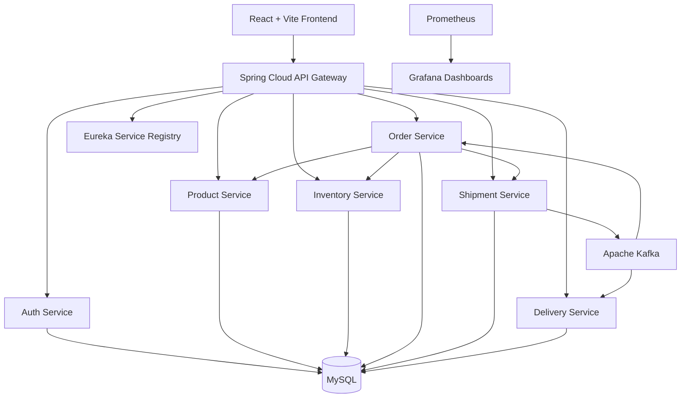

# LogiSphere — Cloud-Native Logistics & Supply Chain Management Platform

LogiSphere is a cloud-native logistics and supply chain management platform built with a microservices architecture. It manages products, inventory, orders, shipments, and deliveries through role-based authentication, REST APIs, and event-driven communication.

## Overview

The platform connects customers, suppliers, administrators, and delivery partners through a centralized application. It uses Spring Boot microservices, Spring Cloud Gateway, Netflix Eureka, Apache Kafka, MySQL, Docker, Kubernetes, Prometheus, and Grafana.

## Key Features

- **Customer operations:** Product browsing, cart checkout, order history, and shipment tracking.
- **Supplier operations:** Store registration, product management, inventory coordination, and order visibility.
- **Delivery operations:** Delivery assignments, driver onboarding, identity verification, and delivery status updates.
- **Administration:** User management, supplier verification, delivery partner verification, and role-based access control.
- **Order management:** Order creation, stock validation, and shipment integration.
- **Event-driven processing:** Kafka-based shipment status updates and service coordination.
- **Service discovery:** Netflix Eureka for microservice registration and discovery.
- **Monitoring:** Prometheus metrics, Grafana dashboards, and Kubernetes monitoring.
- **Containerization:** Docker Compose and Kubernetes deployment configurations.

## Architecture



## Technology Stack

| Area | Technologies |
|---|---|
| Backend | Java 21, Spring Boot, Spring Cloud |
| Frontend | React 19, Vite |
| API Gateway | Spring Cloud Gateway |
| Service discovery | Netflix Eureka |
| Messaging | Apache Kafka, ZooKeeper |
| Database | MySQL 8, Spring Data JPA |
| Security | Spring Security, JWT |
| Containers | Docker, Docker Compose |
| Orchestration | Kubernetes, Minikube, Helm |
| Monitoring | Prometheus, Grafana, Alertmanager |
| Version control | Git, GitHub |

## Project Structure

```text
LogiSphere/
├── backend/
│   ├── api-gateway/
│   ├── auth-service/
│   ├── delivery-service/
│   ├── eureka-server/
│   ├── inventory-service/
│   ├── order-service/
│   ├── product-service/
│   └── shipment-service/
├── frontend/
├── monitoring/
│   ├── dashboards/
│   └── helm-values.yaml
├── scripts/
├── docker-compose.yml
├── grafana-sidecar-values.yaml
└── README.md
```

The exact contents may vary as the project evolves.

## Service Ports

| Component | Port |
|---|---:|
| Frontend | 5173 |
| API Gateway | 8080 |
| Eureka | 8761 |
| Auth Service | 8082 |
| Product Service | 8083 |
| Inventory Service | 8084 |
| Order Service | 8085 |
| Shipment Service | 8086 |
| Delivery Service | 8087 |
| MySQL | 3306 |
| Kafka | 9092 |
| ZooKeeper | 2181 |
| Grafana | 3000 |
| Prometheus | 9091 |

Monitoring ports may require port-forwarding. Verify the actual configuration before use.

## Prerequisites

- Git
- Docker Desktop with Docker Compose
- Java 21 for local backend development
- Node.js and npm for local frontend development
- Minikube and Helm for Kubernetes deployment

## Getting Started

### 1. Clone the repository

```bash
git clone https://github.com/hemalatha2205/CNAD1_Project.git
cd CNAD1_Project
```

### 2. Configure environment variables

Create a local `.env` file using the project's example configuration, if available. Configure database credentials and JWT secrets locally.

**Never commit `.env` files, passwords, private keys, or production credentials.**

### 3. Start the application

From the project root, run:

```bash
docker compose up -d --build
```

Check container status:

```bash
docker compose ps
```

Review logs for services that fail to start:

```bash
docker compose logs --tail=100
```

### 4. Open the application

- Frontend: http://localhost:5173
- API Gateway: http://localhost:8080
- Eureka Dashboard: http://localhost:8761
- Grafana: http://localhost:3000
- Prometheus: http://localhost:9091

Grafana and Prometheus may require the monitoring stack to be running and their port-forwards to be active.

## API Overview

The API Gateway provides the unified entry point for application requests.

| Method | Endpoint | Purpose |
|---|---|---|
| POST | `/auth/login` | Authenticate a user |
| POST | `/auth/register` | Register a customer |
| POST | `/auth/register/supplier` | Register a supplier |
| POST | `/auth/register/delivery` | Register a delivery partner |
| GET | `/products` | Browse products |
| GET | `/products/{id}` | Retrieve product details |
| GET | `/inventory/{productId}` | Check inventory |
| POST | `/orders` | Create an order |
| GET | `/orders/{id}` | Retrieve order details |
| GET | `/shipments/order/{orderId}` | Track a shipment |

Authorization requirements depend on the endpoint and the configured security rules.

## Monitoring and Deployment

The repository includes Docker Compose configuration, Kubernetes/Helm monitoring configuration, and Grafana dashboard definitions.

For Kubernetes monitoring, start the existing Minikube cluster and deploy or update the configured Helm release according to the files in the repository.

Verify that:

- Application health endpoints respond correctly.
- Prometheus targets are reachable.
- Application metrics are being collected.
- Grafana dashboards are provisioned and display available metrics.
- Grafana storage is configured appropriately for persistence.

Refer to the project scripts and deployment configuration for the current setup.

## Security

- Keep credentials and tokens out of source control.
- Use environment variables or an appropriate secrets manager.
- Protect administrative and internal endpoints.
- Avoid exposing management endpoints publicly without access controls.
- Rotate any credential that may have been exposed.

## Future Enhancements

- Demand forecasting and inventory prediction.
- Route optimization.
- Real-time GPS shipment tracking.
- Predictive delivery-delay detection.
- Advanced logistics analytics.

## Project Goal

LogiSphere demonstrates how cloud-native microservices, event-driven communication, centralized API routing, service discovery, and monitoring can support a scalable logistics and supply chain platform.

## License

Add a license file if you intend to distribute the project under a specific open-source license.
